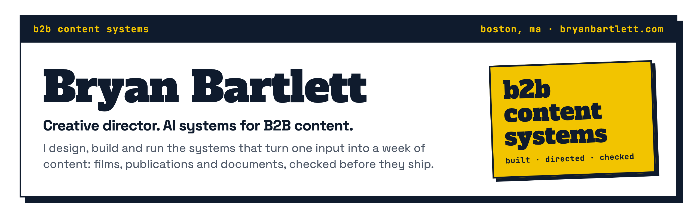

<picture>
  <source media="(prefers-color-scheme: dark)" srcset="assets/banner-dark.png">
  
</picture>

### B2B Content Systems

I build the systems a marketing team uses to ship content that used to need a studio. One input goes in: a PDF, a post, a box of family photos. Finished work comes out: films, publications, web pages and documents. Each step is checked, and a person signs off before anything ships.

Fifteen years of brand and content for marketing technology came first. Now I build the tools that do that work.

### Systems in production

| System | In → out | Status | See it |
|---|---|---|---|
| **Church weekly system** | One bulletin PDF → the website update, sermon images and a live lyric reader for the service | Live. Used every week by Immanuel Community Church | [app.immanuelcommchurch.org](https://app.immanuelcommchurch.org) |
| **mrwilson films** | A LinkedIn post → a 30-second film with the same characters each episode | Live. Episodes published | [Films](https://www.youtube.com/@mrwilsonsays) · [PyPI](https://pypi.org/project/mrwilson/) |
| **YesterYears** | Family photos and home video → a memorial film | In pilot with families | [How it works](https://bryanbartlett.com/lab) |

### Open tools

| Tool | What it does | Tests |
|---|---|---|
| [**ats-resume-check**](https://github.com/bryanbartlett/ats-resume-check) | Finds the résumé PDFs an applicant tracking system cannot read, before you send them |  |
| [**llm-fallback**](https://github.com/bryanbartlett/llm-fallback) | Keeps a tool working when Claude is down by asking Gemini, and says which model answered |  |

### How every system runs

- **One step at a time.** Each step finishes and is checked before the next one starts.
- **A person signs off.** Nothing ships without a go.
- **It keeps working.** When one AI model is down, another answers, and the log says which.
- **It is written down.** Every decision is saved, so the work can be picked up, audited or handed over.

### Track record

Brand and content for marketing technology at **GumGum**, **Adweek BrandShare**, **Chango** and **Dibbs**: magazines, guides, films and events that explained computer vision and ad tech to the people who buy it.

| Work | Year | Result |
|---|---|---|
| [**Art.ificial**](https://bryanbartlett.com/work/art-ificial), a public Turing test for AI art (GumGum) | 2018 | Covered by CNN and CNBC. Two 2019 Effective Digital Marketing Awards |
| **A.N.N. Learns to See**, a cartoon that explains neural networks (GumGum) | 2018 | GumGum's most-viewed video across its social channels |
| **The Programmatic Mind**, a brand magazine for marketing technologists (Chango) | 2013–2015 | Nine issues |

All of it: [bryanbartlett.com/work](https://bryanbartlett.com/work)

### Contact

For roles and projects: [bryanbartlett.com/about](https://bryanbartlett.com/about#contact) or [LinkedIn](https://www.linkedin.com/in/bryanbartlett).

B2B Content Systems · Bryan Bartlett · Boston, MA
